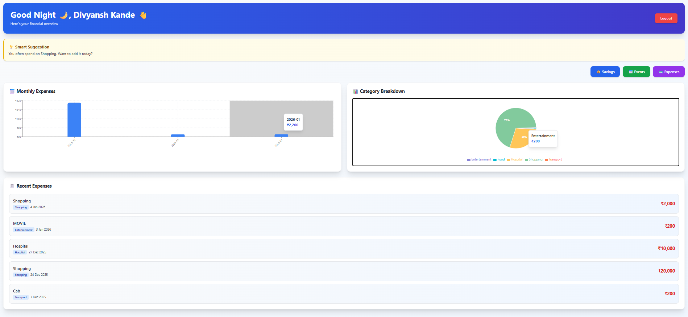

# FinSage - Personal Finance Manager

<p align="center"><b>Track • Save • Grow</b> — A smart, full-stack personal finance web app built with React and Spring Boot</p>

---

## Table of Contents
- [About](#about)
- [Features](#features)
- [Technology Stack](#technology-stack)
- [Repository Structure](#repository-structure)
- [Screenshots](#screenshots)
- [Prerequisites](#prerequisites)
- [Environment Configuration](#environment-configuration)
- [Local Development](#local-development)
- [Docker Deployment](#docker-deployment)
- [Database & Flyway Migrations](#database--flyway-migrations)
- [Testing](#testing)
- [Repository Structure](#repository-structure)
- [Security Notes](#security-notes)
- [Known Limitations](#known-limitations)
- [Contributing](#contributing)
- [License](#license)

---

## About

FinSage is a full-stack personal finance management web application that helps users track expenses, manage savings, plan financial goals, and analyze spending patterns. The application emphasizes secure authentication, meaningful insights, performance, and usability.

---

## Features

### Authentication & Security
- **JWT-based authentication** with access-token cookies (HttpOnly, Secure in production)
- **Password encryption** using BCrypt (strength 12)
- **Google Sign-In** via Firebase Authentication
- **JWT token revocation on logout** — tokens are added to a Redis blocklist with TTL matching their remaining lifetime, so a stolen token cannot be reused after logout
- **Login rate limiting** per email and IP address (Redis-backed, 5 attempts / 15 min window)
- **Protected routes** on frontend and backend with role-based access
- **Global exception handling** — consistent REST error responses via `@RestControllerAdvice`

### Dashboard & Analytics
- Time-based personalized greeting
- Month-wise expense bar charts with hover insights (Recharts)
- Category-wise expense analysis
- Last 5 recent expenses with click-to-navigate
- AI-powered spending suggestions based on user's expense patterns
- Total income, money spent, money saved summary cards
- Savings plan history with previous AI-generated plans

### Savings & Goal Management
- Displays total income, money spent, and money saved
- Monthly expense trend line chart
- Goal tracking with percentage progress bars
- Estimated months to goal completion based on current savings rate
- Highest spending category detection
- **Deterministic savings calculations** — all numeric fields (ideal savings, SIP amount, safe-to-spend, emergency fund months, goal timelines) are computed in Java (`SavingsPlanCalculator`), never invented by the LLM

### AI Financial Assistant
- **Floating chat widget** available on every authenticated page (Dashboard, Expenses, Savings, Events)
- **User-scoped function calling** — the assistant can only query the signed-in user's own data via controlled `FinanceTools`:
  - Income, expense summaries, category breakdowns, monthly trends
  - Recent expenses, highest spending category
  - Savings goals and progress
  - Event budgets and details
- **Spring AI (1.0.0) + OpenRouter** — LLM only generates narrative explanations; all numeric outputs come from deterministic Java calculations
- **Redis caching** — AI responses cached for 6 hours per unique financial profile

### Event Budget Planning
- Create events (weddings, trips, birthdays, etc.) with date and total budget
- Add, update, or delete category-wise expense breakdowns
- Track spending with progress bars and remaining budget
- Edit categories inline with inline bar-chart visualization

### Expense Management with OCR
- Add expenses manually via modal form
- **OCR bill extraction** (Tesseract) — upload a receipt/image/PDF to auto-fill title, amount, category, date
- Dynamic expense list with pagination, filtering, and delete
- Expense suggestions based on recurring patterns (auto-suggested today's expense)

### Savings Plan History
- Every generated savings plan is persisted with inputs (salary, expenses, goals) and full AI response
- History accessible via `/api/savings/plan/history` endpoint
- Frontend "View History" toggle on Savings page

---

## Technology Stack

| Category | Technologies |
|----------|--------------|
| **Frontend** | React 19 (CRA), React Router v7, Tailwind CSS 3, Recharts, Framer Motion, Axios |
| **Backend** | Spring Boot 3.5, Spring Security (JWT), Spring Data JPA, Spring AI 1.0.0, Spring Data Redis, Spring Boot Actuator |
| **Database** | MySQL 8.0 (Flyway migrations), HikariCP connection pool |
| **Caching/Redis** | Redis 7 (AI response caching, login rate limiting, JWT revocation blocklist) |
| **Authentication** | JWT (JJWT 0.11.5), BCrypt (strength 12), Firebase Admin SDK (Google Sign-In) |
| **AI/ML** | Spring AI 1.0.0 (ChatClient, function calling), OpenRouter (OpenAI-compatible), Tesseract OCR |
| **Documentation** | SpringDoc OpenAPI 3 (Swagger UI) |
| **Build/Deploy** | Maven 3.9, Docker (multi-stage), Docker Compose, Nginx (reverse proxy) |
| **Testing** | JUnit 5, Mockito, Spring Boot Test |
| **Frontend Tooling** | React Scripts 5, Tailwind CSS 3, PostCSS, Autoprefixer |

---

## Repository Structure

```
finsage/
├── backend/                    # Spring Boot backend
│   ├── src/
│   │   ├── main/
│   │   │   ├── java/com/example/finsage/
│   │   │   │   ├── config/          # Security, Redis, Spring AI, Flyway, Swagger, GlobalExceptionHandler
│   │   │   │   ├── controller/      # REST endpoints (Auth, Expense, Savings, Events, OCR, AI)
│   │   │   │   ├── model/           # JPA entities, DTOs, AI request/response records
│   │   │   │   ├── repository/      # Spring Data JPA repositories
│   │   │   │   ├── service/         # Business logic (Expense, Savings, AI, Auth, OCR, Event, Redis, JWT)
│   │   │   │   └── service/ai/      # Spring AI function-calling tools & assistant
│   │   │   └── resources/
│   │   │       ├── db/migration/    # Flyway V1__initial_schema.sql
│   │   │       ├── application.properties
│   │   │       └── application-prod.yml
│   │   └── test/                    # JUnit 5 + Mockito tests
│   ├── Dockerfile                  # Multi-stage (Maven build → Temurin JRE + Tesseract)
│   ├── .dockerignore
│   └── pom.xml
├── frontend/                       # React (CRA) frontend
│   ├── public/                     # WebP background assets, favicon, manifest
│   ├── src/
│   │   ├── components/             # AIAssistantWidget, ProtectedRoute, forms, charts
│   │   ├── pages/                  # Dashboard, Expenses, Savings, Events, Landing, Auth
│   │   ├── hooks/                  # useAuth, useDashboardData
│   │   ├── config.js               # Centralized API URL config (REACT_APP_API_URL)
│   │   └── App.js                  # React.lazy/Suspense code-splitting
│   ├── Dockerfile                  # Multi-stage (npm build → Nginx)
│   ├── nginx.conf                  # Reverse proxy to backend, cookie hardening
│   ├── .dockerignore
│   └── package.json
├── docker-compose.yml              # MySQL, Redis, Backend, Frontend
├── .gitignore                      # Root ignore rules (.env, IDE, build, *.json test files)
├── screenshots/                    # App screenshots
└── README.md
```

---

## Screenshots

| Page | Preview |
|------|---------|
| **Homepage** |  |
| **About** |  |
| **Key Features** |  |
| **Login / Register** |  |
| **Dashboard** |  |
| **Savings & Goals** |  |
| **AI Savings Advisor** |  |
| **Events** |  |
| **Expenses** |  |
| **Expense Form + OCR** |  |

---

## Prerequisites

### Local Development
- **Node.js** 18+ (React 19 requires Node 18+)
- **Java** JDK 17 (Temurin/Eclipse Temurin recommended)
- **Maven** 3.9+ (or use included `mvnw` wrapper)
- **MySQL** 8.0+ (local or remote)
- **Redis** 7+ (local `redis-server` or Docker)
- **Tesseract OCR** 5+ with `eng.traineddata` (for OCR feature)

### Docker Deployment
- **Docker** 24+ and **Docker Compose** v2+
- No local Java/Node/MySQL/Redis required

---

## Environment Configuration

Create the following files **before** starting the application. Never commit real credentials.

### Backend (`backend/.env`)
```bash
# Database
DB_URL=jdbc:mysql://localhost:3306/finsage?createDatabaseIfNotExist=true&useSSL=false&allowPublicKeyRetrieval=true
DB_USERNAME=your_mysql_user
DB_PASSWORD=your_mysql_password
DB_ROOT_PASSWORD=your_mysql_root_password

# JWT
JWT_SECRET=your_base64_encoded_secret_at_least_32_bytes

# Email (for password reset)
SPRING_MAIL_HOST=smtp.example.com
SPRING_MAIL_PORT=587
SPRING_MAIL_USERNAME=your_email@example.com
SPRING_MAIL_PASSWORD=your_email_password

# Redis (local dev defaults shown)
REDIS_HOST=localhost
REDIS_PORT=6379
REDIS_PASSWORD=your_redis_password

# AI (OpenRouter via Spring AI)
OPENROUTER_KEY=your_openrouter_api_key
OPENROUTER_MODEL=nvidia/nemotron-3.5-lightning:free

# Firebase (Google Sign-In) — base64-encoded service account JSON
FIREBASE_CREDENTIALS_BASE64=base64_encoded_service_account

# Frontend URL for CORS & password-reset links
FRONTEND_URL=http://localhost:3000

# Cookie security (set "true" only when served over HTTPS)
COOKIE_SECURE=false

# Tesseract OCR
TESSDATA_PATH=/usr/share/tessdata
```

### Frontend (`frontend/.env`)
```bash
REACT_APP_API_URL=http://localhost:8080/api
REACT_APP_FIREBASE_API_KEY=your_firebase_api_key
REACT_APP_FIREBASE_AUTH_DOMAIN=your_project.firebaseapp.com
REACT_APP_FIREBASE_PROJECT_ID=your_project_id
GENERATE_SOURCEMAP=false
```

### Docker Compose (`.env` at repo root for `docker-compose.yml`)
```bash
DB_USERNAME=finsage_user
DB_PASSWORD=secure_password
DB_ROOT_PASSWORD=secure_root_password
JWT_SECRET=base64_encoded_32_byte_secret
SPRING_MAIL_HOST=smtp.example.com
SPRING_MAIL_PORT=587
SPRING_MAIL_USERNAME=email@example.com
SPRING_MAIL_PASSWORD=email_password
OPENROUTER_KEY=your_openrouter_key
OPENROUTER_MODEL=nvidia/nemotron-3.5-lightning:free
FIREBASE_CREDENTIALS_BASE64=base64_encoded_service_account
FRONTEND_URL=http://localhost:3001
REDIS_PASSWORD=redis_password
```

> **Note**: The backend reads most settings via `DotenvEnvironmentPostProcessor` from `.env` → Spring `Environment`. Keys like `DB_URL`, `JWT_SECRET`, `OPENROUTER_KEY`, `FIREBASE_CREDENTIALS_BASE64`, `REDIS_HOST/PORT/PASSWORD`, `FRONTEND_URL`, `COOKIE_SECURE` are mapped to Spring properties automatically.

---

## Local Development

### Option 1: Run Services Individually (Recommended for Development)

**Terminal 1 — MySQL & Redis** (or use Docker for just these two):
```bash
docker run -d --name mysql -e MYSQL_ROOT_PASSWORD=root -e MYSQL_DATABASE=finsage -e MYSQL_USER=finsage -e MYSQL_PASSWORD=finsage -p 3306:3306 mysql:8.0
docker run -d --name redis -p 6379:6379 redis:7-alpine
```

**Terminal 2 — Backend**:
```bash
cd backend
cp .env.example .env   # then edit with your values
./mvnw spring-boot:run
```
Backend runs at `http://localhost:8080`

**Terminal 3 — Frontend**:
```bash
cd frontend
cp .env.example .env   # then edit with your values
npm install
npm start
```
Frontend runs at `http://localhost:3000` (proxies `/api` to backend via CRA proxy)

### Option 2: Root Package.json (Optional Convenience)
Create a root `package.json`:
```json
{
  "name": "finsage-root",
  "private": true,
  "scripts": {
    "install-all": "npm install --prefix frontend && cd backend && ./mvnw install -DskipTests",
    "start": "concurrently \"cd backend && ./mvnw spring-boot:run\" \"cd frontend && npm start\""
  },
  "devDependencies": {
    "concurrently": "^8.2.0"
  }
}
```
Then:
```bash
npm install
npm run install-all
npm start
```

---

## Docker Deployment

```bash
# From repository root
cp .env.example .env   # fill in all values
docker compose up --build -d
```

**Services exposed**:
- Frontend (Nginx): `http://localhost:3001`
- Backend API: `http://localhost:8081` (internal port 8080)
- MySQL: `localhost:3308` (internal 3306)
- Redis: `localhost:6379`

**Volumes**: `mysql_data`, `redis_data`, `uploads` (persist across restarts)

**Healthchecks**: MySQL and Redis have healthchecks; backend/frontend wait for them.

---

## Database & Flyway Migrations

- **Flyway** is enabled (`spring.flyway.enabled=true`)
- Migration location: `src/main/resources/db/migration/`
- **Baseline-on-migrate=true** — existing schemas without Flyway history are baselined at version 1 (no data loss)
- **Validate-on-migrate=true** — checksum validation runs before applying
- **Current migration**: `V1__initial_schema.sql` (creates all 8 tables: users, expense, savings_goal, events, event_category_breakdown, savings_plan_history, expense_suggestion, password_reset_token)
- **Reference schema**: `src/main/resources/db/init-schema.sql` (kept for reference; Flyway uses the versioned migration)
- **Hibernate**: `ddl-auto=validate` — schema must match entities exactly; no auto-create

> **Fresh database**: Flyway runs `V1__initial_schema.sql` on startup, creates `flyway_schema_history`, then Hibernate validates.
>
> **Existing database**: Flyway baselines at v1 (records current state), then validates. No DDL executed.

---

## Testing

### Backend
```bash
cd backend
./mvnw test
```
**Last run (16 tests)**:
- `ExpenseServiceDateFilterTest` — 6 tests ✅
- `FinsageApplicationTests` (context loads) ✅
- `UserServiceTest` — 9 tests ✅
- **Total: 16 tests, 0 failures, 0 errors**

### Frontend
```bash
cd frontend
npm test -- --watchAll=false
```
Runs React Testing Library / Jest suite.

### Build Verification
```bash
# Backend
cd backend && ./mvnw clean package -DskipTests

# Frontend
cd frontend && npm run build
```
Production build completes successfully (ESLint warnings only: unused `Legend` import, 3 anchor `href` accessibility warnings).

---

## Security Notes

- **JWT tokens**: HttpOnly cookies, `SameSite=Lax` (dev) / `SameSite=None; Secure` (prod), 30-hour expiry
- **Token revocation**: On logout, token JTI added to Redis blocklist with TTL = remaining token lifetime
- **Passwords**: BCrypt strength 12, minimum 6 chars, never logged
- **Google Sign-In**: Firebase ID token verified server-side; local account created/linked on first login
- **CORS**: Configurable via `FRONTEND_URL` (comma-separated origins)
- **Rate limiting**: 5 login attempts per email/IP per 15 minutes (Redis)
- **AI responses cached**: 6-hour TTL per financial profile hash (Redis)
- **OCR uploads**: Stored in `uploads/` volume, not served publicly
- **Actuator endpoints**: `/actuator/health`, `/actuator/info`, `/actuator/metrics`, `/actuator/prometheus` (exposed; secure in prod)

---

## Known Limitations

- **No automated Flyway migration tests** — V1 migration tested against existing DB only; fresh-DB initialization not yet CI-verified
- **Tesseract OCR** requires system-level install; Dockerfile includes `tesseract-ocr` + `eng.traineddata`
- **OpenRouter free-tier models** may have rate limits / latency; `spring.ai.retry.max-attempts=2` configured
- **Frontend build** uses React Scripts 5 (CRA) — consider Vite migration for faster builds
- **No dark mode** yet
- **No PDF/Excel export** for reports
- **Single-currency (INR)** — multi-currency not implemented

---

## Contributing

1. Fork the repository
2. Create a feature branch: `git checkout -b feat/your-feature`
3. Commit changes: `git commit -m "feat: your feature description"`
4. Push branch: `git push origin feat/your-feature`
5. Open a Pull Request

---

## License

This project is licensed under the MIT License — see the [LICENSE](LICENSE) file for details.