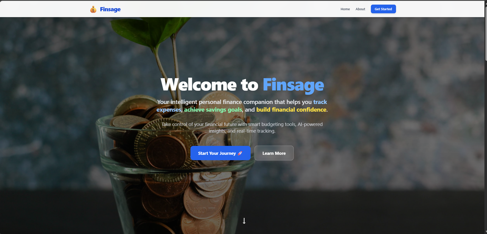
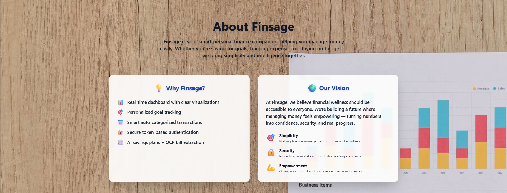
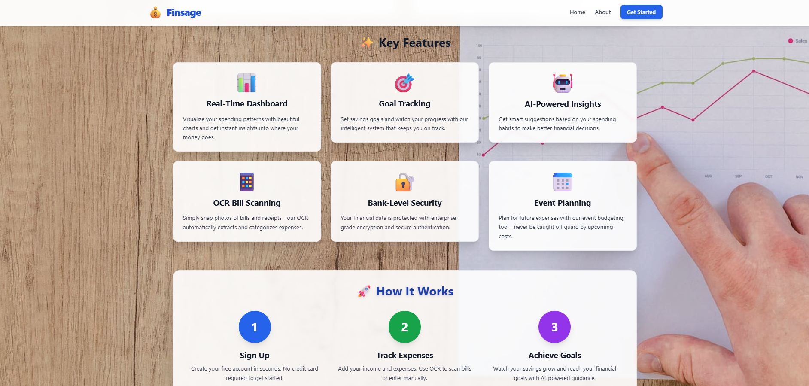
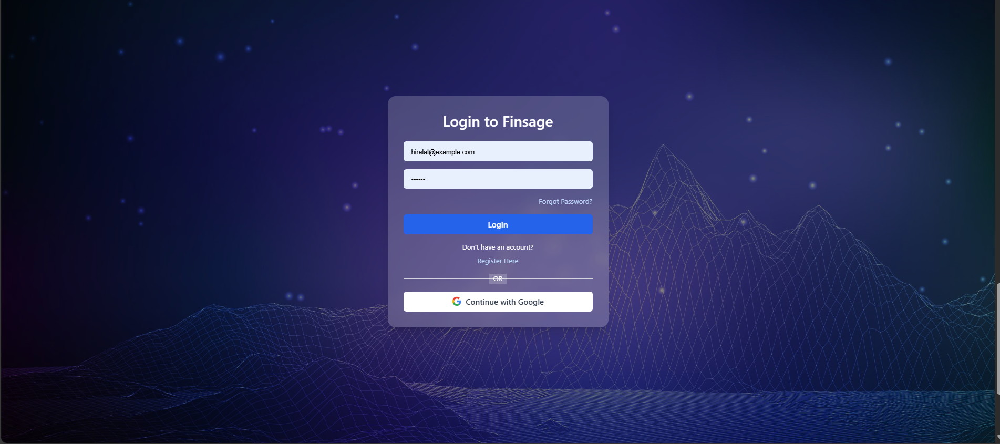
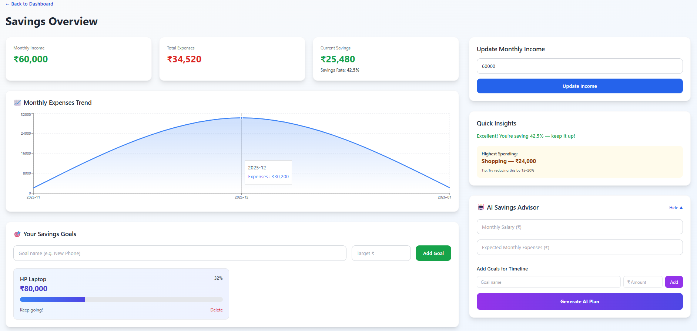
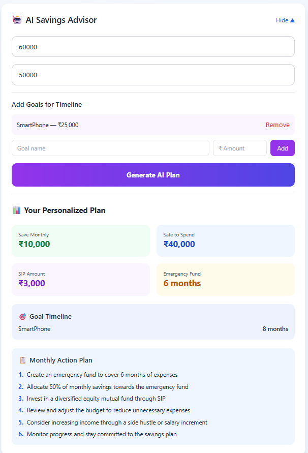
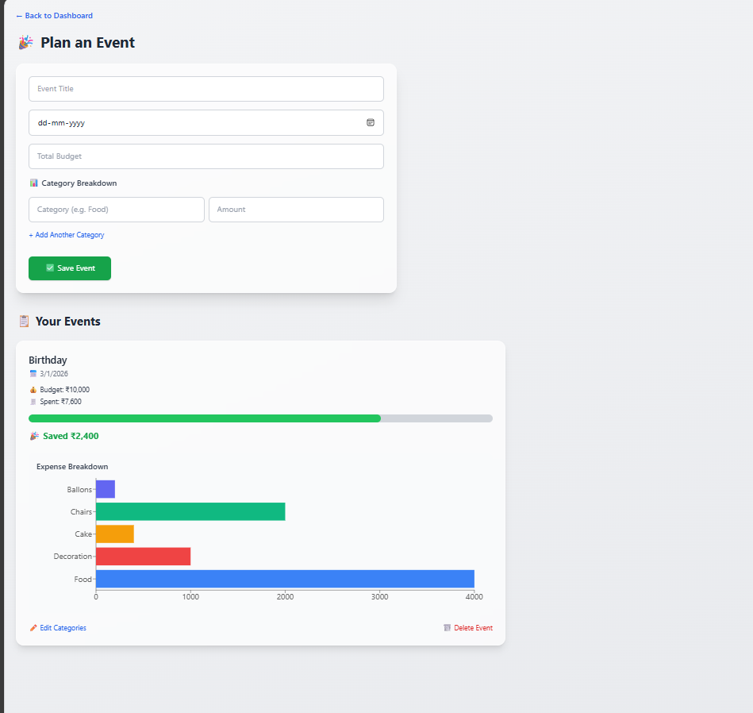
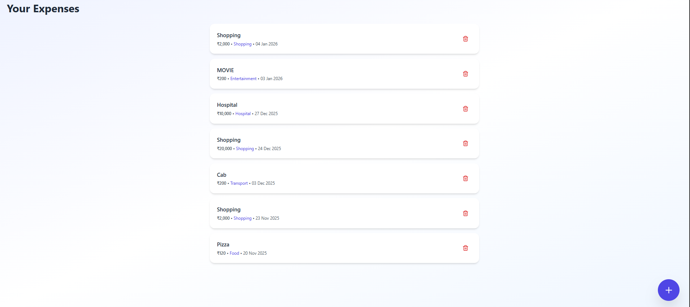

<h1 align="center">💰 Finsage – Personal Finance Manager</h1>
<p align="center"><b>Track • Save • Grow</b> – A smart, full-stack personal finance web app built with React and Spring Boot</p>


---

## 📌 Table of Contents
- [About](#about)
- [Features](#features)
- [Tech Stack](#tech-stack)
- [Repository Structure](#repository-structure)
- [Screenshots](#screenshots)
- [Installation](#installation)
- [Usage](#usage)
- [Environment Variables](#environment-variables)
- [Future Scope](#future-scope)
- [Challenges&Learning](#-challenges--learnings)
- [Contributing](#contributing)
- [License](#license)

---

## 📖 About
FinSage is a full-stack personal finance management web application that helps users track expenses, manage savings, plan financial goals, and analyze spending patterns.

The application is designed by keeping real users in mind, focusing on secure authentication, meaningful insights, performance, and usability rather than just adding features.

---

## ✨ Features
🔐 ***Authentication & Security***

JWT-based login and registration
Password encryption using BCrypt
Google Login using Firebase Authentication
Proper logout and session handling

📊 ***Dashboard & Analytics***

Time-based greeting for users
Month-wise expense bar charts with hover insights
Category-wise expense analysis
Last 5 recent expenses
Spending suggestions based on expense patterns

💰 ***Savings & Goal Management***

Displays total income, money spent, and money saved
Monthly expense trend using a line chart
Goal tracking (e.g., buying a laptop) with percentage progress bar
Shows highest spending category

🤖 ***AI Savings Plan***

User enters income, expenses, and goal details

AI generates:
Time required to achieve the goal
SIP amount
Emergency fund allocation

Monthly spending limit
Overall savings summary

🎉 ***Event Budget Planning***

Create events (wedding, birthday, etc.)
Set budget and event date
Add, update, or delete event expenses
Track event spending with progress bars

🧾 ***Expense Management with OCR***

Add expenses manually using a form
OCR-based bill extraction to auto-fill expense details
Dynamic expense list generation

---

## 🛠 Tech Stack
| **Category**       | **Technologies**                               |
|--------------------|----------------------------------------------- |
| **Frontend**       | React (CRA), Tailwind CSS                      |
| **Backend**        | Spring Boot, Spring Security(JWT), Java        |
| **Database**       | MySQL                                          |
| **Authentication** | BCrypt Password Encoder, FireBase Google Login |
| **Tools**          | Postman, Maven, npm                            |
| **AI & OCR**       | AI APIs, OCR Integration                       |   
---

## 📁 Repository Structure
finsage/
├── backend/                    # Spring Boot backend source code
│   ├── src/                    # Backend source files
│   ├── .env                    # Environment variables (DB, mail, secrets)
│   └── pom.xml                 # Maven configuration
├── frontend/                   # React frontend source code
│   ├── src/                    # Frontend source files
│   └── package.json            # Frontend dependencies
├── package.json                # Root-level scripts for running both apps
└── README.md                   # Project documentation


---

## 📸 Screenshots

  
*Homepage with sections for Home, About & Login*

  
*About page explaining FinSage and its purpose as a personal finance management application*

 
*Overview of key features including expense tracking, savings, goals, events, and AI insights.* 

  
*Login/Register page where users authenticate using JWT or FireBase Google Login and proceed to their personalized dashboard.*


*User dashboard showing expense analytics, month-wise bar charts with hover insights, recent expenses and category wise breakdown of expenses pie chart showcase*


*Savings page showing total income, money spent, money saved, monthly expense trend, and goal progress,highest spending expenditure*

 
*AI-powered savings advisor that generates a personalized savings plan based on income, monthly expenses, and financial goals.*


 
*Event budgeting page where users can create events, set budgets, add expenses, and track overall spending using progress bars.* 

  
*Expense management page displaying the list of user expenses with category and date details.*

  
*Add expense form with OCR-based bill extraction to automatically fill expense details.*


---

## 🛠 Installation

### 📋 Prerequisites
- **Node.js**: v16 or higher
- **Java**: JDK 17 or higher
- **Maven**: Latest stable version
- **MySQL**: Server running locally or remotely

### 📥 Steps
1. **Clone the Repository**:
   ```bash
   git clone https://github.com/divyanshkande/finsage.git
   cd finsage
```

 ⚡ One-Time Setup for Combined Start
 Create a root-level `package.json`:
```bash
npm init -y
```
### Install concurrently in the root:
```bash
npm install concurrently
```
### Edit root package.json and add:
```bash
"scripts": {
  "start": "concurrently \"mvn -f backend/pom.xml spring-boot:run\" \"npm start --prefix frontend\"",
  "install-all": "npm install --prefix frontend && mvn -f backend/pom.xml install"
}
```

### Install frontend dependencies:
```bash
npm install --prefix frontend
```
### Install backend dependencies:
```bash
mvn -f backend/pom.xml install
```
## 🚀 Usage (Quick Start)
### From the root of the project:
```bash
npm start
```
This will:

Start the backend at http://localhost:8080
Start the frontend at http://localhost:3000

Open http://localhost:3000 in your browser to access the app.

## 🔐 Environment Variables
Backend (backend/.env):
```bash
DB_USERNAME=your_mysql_username
DB_PASSWORD=your_mysql_password
JWT_SECRET=your_jwt_secret
SPRING_MAIL_HOST=smtp.example.com
SPRING_MAIL_PORT=587
SPRING_MAIL_USERNAME=your_email@example.com
SPRING_MAIL_PASSWORD=your_email_password
```
Your backend/src/main/resources/application.properties should use:
```bash
spring.datasource.username=${DB_USERNAME}
spring.datasource.password=${DB_PASSWORD}
jwt.secret=${JWT_SECRET}
spring.mail.host=${SPRING_MAIL_HOST}
spring.mail.port=${SPRING_MAIL_PORT}
spring.mail.username=${SPRING_MAIL_USERNAME}
spring.mail.password=${SPRING_MAIL_PASSWORD}
```
---

## 🧠 Challenges & Learnings

Selecting the right AI API for clear and useful responses
Implementing JWT-based authentication correctly
Integrating Firebase Google Login with backend authorization
Debugging token flow and authentication issues
Avoided adding excessive UI features to keep the app fast
Learned how real web apps work end-to-end using REST APIs

---

## 🔮 Future Scope

Dark mode
AI-based expense prediction
Monthly spending alerts
Multi-currency support
Export reports (PDF/Excel)


## 🤝 Contributing

Fork the repository 🍴
Create a feature branch 🌿
Commit your changes ✅
Open a Pull Request 🚀


## 📜 License

This project is licensed under the MIT License.